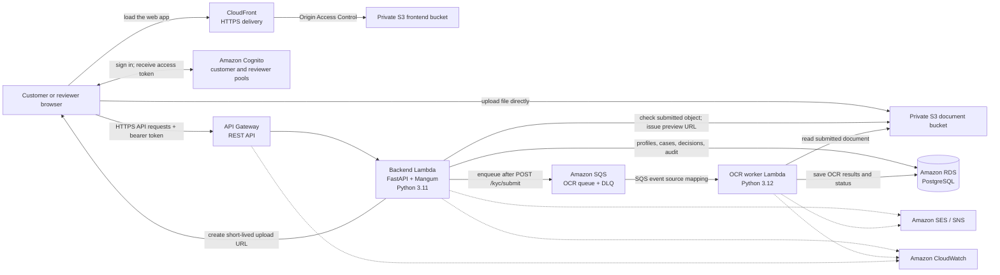

# Pramāṇa — KYC Document Verification System

Pramāṇa is a web application for customer identity-document submission and reviewer-led KYC decisions. Customers manage their profile, upload Aadhaar or PAN documents, and follow case status. Reviewers inspect cases that need attention and record a decision.

## Use the deployed application

- **Website:** [Open Pramāṇa](https://d231rykprgnarh.cloudfront.net)
- **API Gateway base URL:** [https://rimait7lg7.execute-api.us-east-1.amazonaws.com/dev](https://rimait7lg7.execute-api.us-east-1.amazonaws.com/dev)

For normal use, open the website. The deployed frontend calls the API Gateway backend; the API URL is provided for integration and troubleshooting, not as a separate user interface. No local installation is needed to use the deployed application.

The project runbooks report a synthetic end-to-end API, upload, OCR, and reviewer flow. SES production email access and SNS SMS activation are not available, so real notification delivery is not verified. See [infra/README.md](infra/README.md) for the dated deployment status.
## Architecture

The application’s AWS resources are primarily deployed in **US East (N. Virginia), us-east-1**. CloudFront is a global service.

### Components

| Component | Responsibility |
| --- | --- |
| React + TypeScript + Vite frontend | Customer and reviewer single-page application. React Router handles client-side routes; AWS Amplify Auth connects to Cognito. |
| CloudFront and frontend S3 bucket | Serve the static frontend over HTTPS. The bucket is private and CloudFront accesses it through Origin Access Control (OAC). |
| Amazon Cognito | Separate customer and reviewer user pools. The frontend uses Cognito access tokens; the API verifies tokens and enforces customer/reviewer access. |
| API Gateway REST API | HTTPS entry point that forwards requests to the FastAPI Lambda. FastAPI handles application authentication and authorization. |
| Backend Lambda | Python 3.11 application using FastAPI and Mangum. Handles registration, profile and KYC APIs, presigned URLs, SQS submission, reviewer decisions, audit records, and notification calls. |
| KYC document S3 bucket | Private object storage for uploaded Aadhaar/PAN images and PDFs. The browser uploads with a temporary presigned URL; file bytes do not pass through the API. |
| Amazon SQS and dead-letter queue | Buffer submitted OCR jobs and isolate messages that repeatedly fail. POST /kyc/submit is the queue producer; S3 object-created events do not start OCR. |
| OCR worker Lambda | Python 3.12 worker invoked from SQS. It reads documents, renders PDF pages when needed, runs Tesseract/OpenCV/PDFium processing, compares fields, and persists results. The worker is conditionally enabled by the infrastructure template. |
| Amazon RDS for PostgreSQL | Stores customer profiles, KYC cases and attempts, document metadata, extracted fields, comparisons, reviewer decisions, and audit events. |
| VPC, security groups, IAM, and Secrets Manager | Keep the database private, restrict database access to approved application security groups, grant scoped AWS permissions, and provide database credentials to Lambdas. |
| Amazon SES and SNS | Email and SMS notification providers. Delivery availability depends on account and service activation. |
| Amazon CloudWatch | Lambda/API logs, operational metrics, alarms, and dashboards. |
| AWS SAM and CloudFormation | Define the shared network/OCR foundation, backend API, database, and supporting infrastructure as separate components. |

### Verification flow

1. A customer registers and confirms their email through the backend and Cognito.
2. After signing in, the customer requests an upload URL from POST /kyc/upload-url.
3. The browser uploads the JPEG, PNG, or PDF directly to the private S3 document bucket.
4. The customer calls POST /kyc/submit. The backend checks the uploaded object, records its metadata, and sends a job to SQS.
5. The SQS event source mapping invokes the OCR worker. The worker downloads the document, renders PDF pages if needed, preprocesses the image, and extracts text.
6. The worker normalizes and compares the required extracted fields with the customer profile, then stores the result in PostgreSQL.
7. A complete match becomes AUTO_VERIFIED. Missing or mismatched required fields become REVIEW_REQUIRED.
8. A reviewer can approve, reject, or request a re-upload. The decision and audit event are recorded in PostgreSQL.

| Document | Required fields for automatic verification |
| --- | --- |
| Aadhaar | Name, date of birth, gender |
| PAN | Name, date of birth |

The comparison uses normalized exact matching. It does not use fuzzy matching, an LLM, or government-database lookups; OCR alone does not establish that a document is genuine.

## Project structure

~~~text
.
├── backend/                 # FastAPI API, PostgreSQL models/migrations, backend SAM template
│   ├── app/                 # Routers, schemas, models, services, configuration
│   ├── infrastructure/     # Database CloudFormation component
│   └── migrations/          # Alembic schema migrations
├── frontend/                # React + TypeScript + Vite application
├── infra/
│   ├── sam/                 # Shared VPC, S3, SQS, OCR worker and operations resources
│   ├── ocr/                 # OCR worker source, tests and Lambda layer build
│   ├── shared/              # Shared notification package and Lambda layer source
│   ├── schema_inspector/    # Read-only database schema inspection component
│   └── admin_psql_access/   # Restricted administrator database access component
├── context/                 # Project context and ownership notes
└── implementation/          # Integration decisions, handoffs and deployment evidence
~~~

Useful entry points:

- frontend/src/App.tsx — frontend application and routes.
- backend/app/main.py — FastAPI application and Lambda handler.
- backend/app/routers/ and backend/app/services/ — API routes and business integrations.
- backend/migrations/ — Alembic migrations.
- infra/sam/template.yaml — shared network, storage, queue, OCR worker, and operations resources.
- infra/ocr/src/pramana_ocr/worker.py — OCR worker entry point.
- backend/template.yaml — backend API Lambda and API Gateway component.
- backend/infrastructure/database.yaml — PostgreSQL database component.

## Optional local development

The following setup is for contributors who need to change or debug the application locally. It is not required to use the deployed website above.

### Local requirements

- Node.js and npm for the frontend.
- Python 3.11 or later for the backend (the deployed backend Lambda uses Python 3.11).
- PostgreSQL for backend integration and migrations.
- Docker plus Linux, macOS, WSL, or another Bash environment to build the OCR Lambda layer.
- AWS credentials and permissions only for real AWS integration or deployment.

### Run the frontend locally

In PowerShell:

~~~powershell
Set-Location frontend
npm ci
Copy-Item .env.example .env.local
~~~

Edit frontend/.env.local:

- For an offline UI walkthrough, set VITE_USE_MOCKS=true.
- For backend integration, set VITE_USE_MOCKS=false, set VITE_API_BASE_URL=http://localhost:8000, and configure the customer and reviewer Cognito pool/client IDs for the environment you will use.

Start the development server:

~~~powershell
npm run dev
~~~

Vite serves the app at [http://localhost:3000](http://localhost:3000). For backend integration, the API must allow this browser origin through CORS. Build the static site with:

~~~powershell
npm run build
~~~

The production output is written to frontend/dist/. Values prefixed with VITE_ are embedded in browser assets and must be treated as public configuration, never as secrets.

### Run the backend locally

The UI can run in mock mode without the API. A real backend workflow needs a reachable PostgreSQL database and suitable Cognito/AWS configuration. The deployed RDS database is private; a local machine needs an approved network path or a local development database.

In a second PowerShell terminal:

~~~powershell
Set-Location backend
py -3.11 -m venv .venv
.\.venv\Scripts\Activate.ps1
python -m pip install -r requirements-dev.txt
python -m pip install -e ..\infra\shared
Copy-Item .env.example .env
~~~

Edit backend/.env with the database connection and the AWS/Cognito settings needed for the workflow. Then apply migrations and start the API:

~~~powershell
alembic upgrade head
uvicorn app.main:app --reload --port 8000
~~~

Keep this terminal running while using the frontend. The API listens at [http://localhost:8000](http://localhost:8000).

## Build the OCR Lambda layer

Run from the repository root in Bash, WSL, or Linux with Docker installed:

~~~bash
bash infra/ocr/scripts/build_layer.sh
~~~

The script builds Lambda-compatible native OCR dependencies. See [infra/README.md](infra/README.md) for template validation, OCR/backend test commands, packaging details, and the current deployment review process.

## Deployment

Infrastructure is split across templates and has ordered dependencies: the shared foundation, database, backend API, and OCR worker consume outputs from one another. There is no single safe, parameter-free deployment command. Follow [infra/README.md](infra/README.md), [backend/README.md](backend/README.md), and the relevant files under implementation/ for the current parameters, migration order, and change-set review process. Review CloudFormation changes before execution.

## Security and project status

- Never commit .env files, credentials, tokens, private keys, or database passwords. Commit example configuration with placeholders only.
- Do not put secrets in frontend VITE_ variables.
- Use synthetic identity documents for demonstrations and tests. Real identity documents require appropriate privacy, consent, retention, and security controls.
- The repository's deployment notes dated 2026-10-31 report a deployed frontend/API and a synthetic end-to-end KYC flow. They also report that SES production sending access and SNS SMS activation are not available, so real notification delivery is not verified. See the linked infrastructure and implementation handoff notes for updated state.
- No project license file is currently present. Select and add a license before public distribution.
